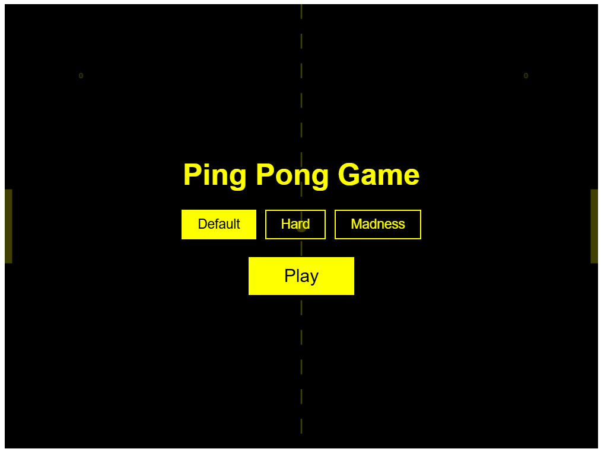
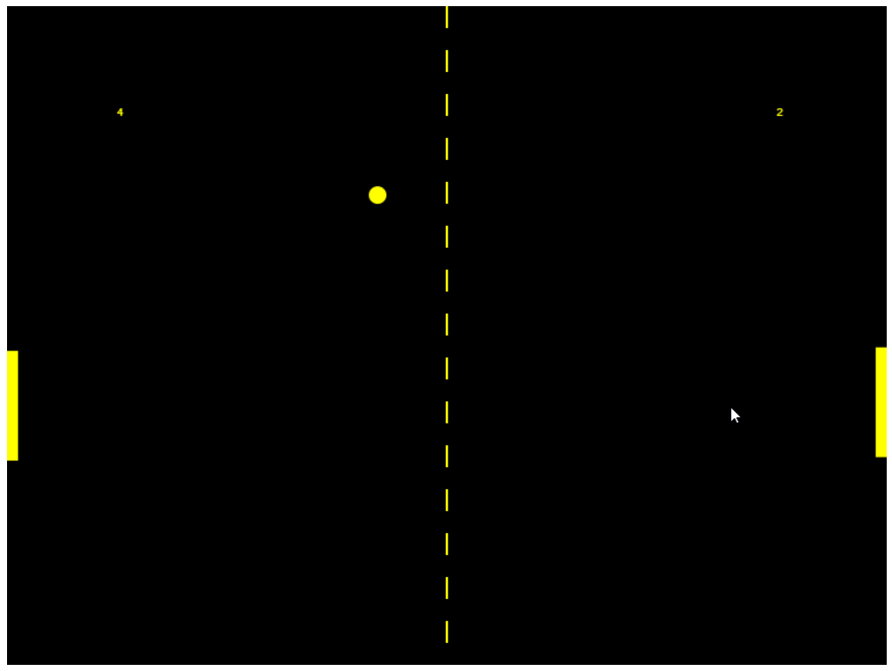
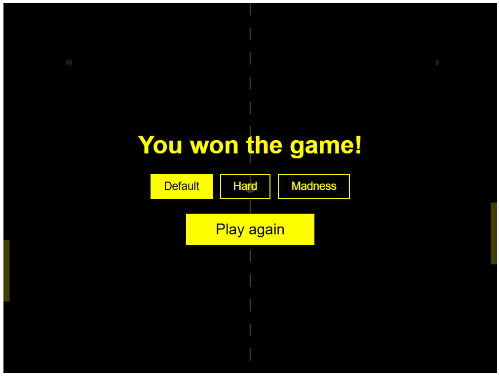

# СПм-25-1, Олешко Владислав Миколайович

## Домашнє завдання.

## Варіант "Реалізація ботів". Створення ігрового бота для гри "Ping Pong".

Для роботи використовується розроблена мною версія гри "Ping Pong". Фінальна версія доступна у репозиторій GitHub за посиланням - https://github.com/vladyslav-oleshko/csim-homework.

### Мета роботи
Навчитись створювати імітаційного ігрового бота.

### Хід роботи
Вихідний код гри був написаний у 2019 році. У рамках цього домашнього завданнях код був доведений до робочої версії та отримав кілька покращень.
Було додано ще два рівні складності та один патерн поведінки. У стандартній версії бот діяв виключно реактивно, постійно наздоганяючи реальність. У розширеній версії, на вищому рівні складності, бот діє предиктивно

Бот у грі працює у циклі за патерном "збір даних - рішення - дія", який повторюється 60 разів на секунду (в кожному тіку ігрової фізики). Патерн працює приблизно так:
1) Збір даних. Бот бере поточну позицію та швидкість м'яча.
2) Рішення. Бот розраховує цільову координату Y, в яку треба перевести центр ракетки (платформи). Якщо бот діє реактивно, то цільова координата платфоми = поточній позиції м'яча. Тобто бот просто наздоганяє м'яч. Якщо бот діє предиктивно, то цільова координата = розрахованій точці падіння м'яча + закладена похибна.
3) Ракетка/платформа зсувається до цілі на фіксований крок (залежить від швидкості бота), якщо довжина цього кроку більша за "мертву" зону бота.

<pre>
  const difficulties = {
    default: { AISpeed: 3.2, padding: 40, predict: false },
    hard:    { AISpeed: 4.5, padding: 20, predict: true, reactionX: 500, error: 60 },
    madness: { AISpeed: 5,   padding: 10, predict: true, reactionX: 500, error: 30 }
  };
</pre>

Код вище визначає три рівні складності. За бажання можна внести зміни лише у цей масив й змінювати більше нічого, щоб змінити поведінку бота.

### Кілька зображень ігрових станів

### Висновок

У ході домашньої роботи я реалізував комп'ютерного суперника у грі Ping Pong з трьома рівнями складності: реактивним ботом і ботом, що передбачає траєкторію м'яча за допомогою покрокової імітаційної моделі руху, з урахуванням часу реакції та випадкової похибки прогнозу. Робота дала мені практичні навички проєктування поведінки ігрового агента та підбору параметрів моделі за результатами експериментів.
